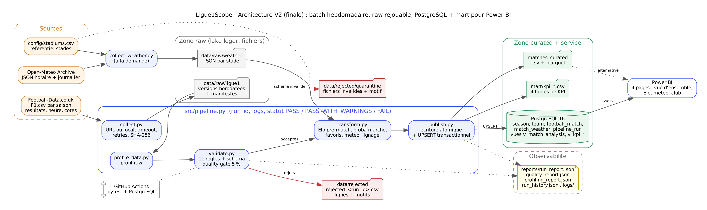

# Ligue1Scope

Projet final **Architectures BD et collecte de données** (ESEO 2026-2027). Un pipeline batch collecte les résultats et les cotes de Ligue 1, ainsi que la météo au stade. Il contrôle leur qualité, calcule un Elo pré-match et publie un produit de données (CSV/Parquet, PostgreSQL, Power BI) pour préparer un match.

## 1. Problème, utilisateur et question

- **Utilisateur :** analyste performance ou vidéo d'un staff de Ligue 1 qui prépare le dossier de l'adversaire.
- **Problème :** le discours d'avant-match (« match à notre portée », « match piège ») repose souvent sur l'intuition. On ne sait pas quels facteurs de contexte méritent d'être suivis.
- **Décision rendue possible :** calibrer le niveau de favori d'un match et décider quels facteurs de contexte suivre (rapport de force, terrain, météo).
- **Question centrale :** *Avant un match de Ligue 1, dans quelle mesure l'écart de force Elo, l'avantage du terrain et la météo permettent-ils d'anticiper le résultat, comparé au consensus des bookmakers ?*
- **Périmètre :** Ligue 1, saisons 2016-2017 à 2025-2026 (3 477 matchs). 2016-2017 sert de saison de chauffe pour l'Elo et est exclue des KPI. Hors périmètre : joueurs, compositions, événements de match, rentabilité des paris.
- **Fréquence utile :** hebdomadaire en saison (après chaque journée), ponctuelle hors saison.

| Cas d'usage (en tant qu'analyste, je veux…) | KPI | Résultat (2017-2026, 3 097 matchs) |
|---|---|---|
| …savoir si le favori Elo gagne vraiment, afin de doser le discours | % de victoires du favori Elo | **50,8 %** |
| …mesurer l'avantage du terrain selon l'écart de niveau, afin d'adapter l'objectif du match | % de victoires à domicile par tranche d'écart Elo | **16,8 %** si l'écart est < −200, puis **71,8 %** si l'écart est ≥ 200 |
| …savoir si la météo doit entrer dans la préparation | buts moyens par classe de température et de pluie | de 2,56 (< 5 °C) à 3,01 (20-25 °C) ; quasi plat selon la pluie (2,72 à 2,78) |
| …situer l'Elo face au marché, afin de savoir si l'Elo suffit | % de victoires du favori du marché ; accord Elo/marché | **52,2 %** ; même favori dans **89,4 %** des matchs |

**Réponse courte :** l'écart Elo est fortement discriminant. Le taux de victoire à domicile est multiplié par 4,3 entre les tranches extrêmes. Le simple Elo n'est battu par les cotes que d'environ 1,4 point. La météo a un effet faible : légère hausse des buts par temps doux, aucun effet net de la pluie (météo disponible pour 100 % des matchs). Ce sont des **associations descriptives, pas des causes** (voir [docs/hypotheses.md](docs/hypotheses.md)).

## 2. Sources et conformité

| Source | Rôle | Accès | Conditions |
|---|---|---|---|
| [Football-Data.co.uk](https://www.football-data.co.uk/francem.php) `F1.csv` | résultats, heure, cotes moyennes | HTTP public, sans clé | fichiers gratuits ; citer la source ; voir le disclaimer |
| [Open-Meteo Archive](https://open-meteo.com/en/docs/historical-weather-api) | température, pluie, vent | API JSON, sans clé | CC BY 4.0, non commercial, < 10 000 appels/jour |
| Elo interne (`src/compute_elo.py`) | force relative pré-match | calcul local | remplace ClubElo (HTTP 502 persistant le 25/09/2026) |

Aucune donnée personnelle, aucun secret dans le dépôt (`.env` est ignoré, `.env.example` est fourni). Données Football-Data collectées le 25/09/2026, pages consultées le 12/10/2026. Les fiches sources détaillées sont dans [docs/sources.md](docs/sources.md).

## 3. Architecture



```text
Football-Data ─► collect.py ─► data/raw/ligue1 (horodaté, SHA-256) ─┐       ┌─► data/rejected (lignes + motifs)
Open-Meteo ─► collect_weather.py ─► data/raw/weather ─────────────┐ │       │   data/rejected/quarantine (fichiers)
                                                                  ▼ ▼       │
                    pipeline.py : profile ─► validate (11 règles + gate 5 %) ─► transform (Elo, marché, météo)
                                                                                   └─► publish : curated CSV/Parquet + mart
                                                                                                 + PostgreSQL (UPSERT) ─► Power BI
                    observabilité : reports/run_report.json, quality_report.json, profiling_report.json, logs/, run_history.jsonl
```

- V1 (séances 1-2) : [architecture_v1.png](docs/architecture/architecture_v1.png). V2 (finale) : [architecture_v2.png](docs/architecture/architecture_v2.png). Lineage des champs : [lineage.png](docs/architecture/lineage.png). Chaque diagramme existe aussi en SVG, avec sa source `.dot`.
- Décisions : [ADR-001 Architecture cible](docs/adr/ADR-001-architecture-cible.md) (fichiers seuls / PostgreSQL + mart / cloud ; batch ou streaming) et [ADR-002 Stockage PostgreSQL + UPSERT](docs/adr/ADR-002-stockage-postgresql.md).
- Grain : **une ligne = un match**. Clé métier : (saison, date, domicile, extérieur), d'où `match_id`.

## 4. Installation

Prérequis : Python 3.11 ou plus. PostgreSQL 16 est optionnel (Docker Desktop, ou un serveur existant).

```powershell
py -3.11 -m venv .venv
.\.venv\Scripts\Activate.ps1          # bash : source .venv/bin/activate
python -m pip install --upgrade pip
python -m pip install -r requirements.txt
```

Base PostgreSQL (optionnelle) :

```powershell
Copy-Item .env.example .env           # puis adapter le mot de passe local
docker compose up -d
$env:DATABASE_URL = "postgresql://ligue1scope:<mot_de_passe>@localhost:5432/ligue1scope"
```

## 5. Exécution

```powershell
python src/pipeline.py                 # rejoue toute la chaîne depuis la zone raw (sans réseau)
python src/pipeline.py --collect url   # télécharge d'abord les saisons depuis Football-Data
python src/pipeline.py --collect local --source-dir data/source_seasons   # 16-17.csv, 17-18.csv...
python src/pipeline.py --no-db         # n'essaie pas PostgreSQL
python -m pytest -q                    # 44 tests ; les 3 tests PostgreSQL ne tournent que si TEST_POSTGRES_DSN est défini
python src/incident_drill.py           # exercice d'incident, 7 scénarios
python src/collect_weather.py --team "Lyon"        # (re)collecter la météo d'un stade (réseau)
```

Code de sortie : 0 pour `PASS` ou `PASS_WITH_WARNINGS`, 1 pour `FAIL`. Le statut attendu aujourd'hui est `PASS_WITH_WARNINGS`, car la règle de fraîcheur signale que la saison 2026-2027 n'est pas encore collectée (dernier match : 17/05/2026).

## 6. Contrat, qualité et rejets

Contrat versionné : [config/data_contract.yaml](config/data_contract.yaml) (v2.0, avec changelog). Dictionnaire : [docs/dictionnaire_donnees.md](docs/dictionnaire_donnees.md). Paramètres : [config/pipeline.yaml](config/pipeline.yaml).

| Id | Règle | Dimension | Action en cas d'échec |
|---|---|---|---|
| SCHEMA | fichier non vide, colonnes obligatoires présentes | Validité | quarantaine + repli sur la version précédente |
| R1 | champs obligatoires renseignés | Complétude | rejet |
| R2 | date réelle (JJ/MM/AA ou JJ/MM/AAAA) | Validité | rejet |
| R3 | buts entiers dans [0, 15] | Validité | rejet |
| R4 | date comprise dans la saison du fichier | Cohérence | rejet |
| R5 | FTR cohérent avec le score | Cohérence | rejet |
| R6 | domicile ≠ extérieur | Cohérence | rejet |
| R7 | clé métier unique | Unicité | 1re occurrence gardée, copies rejetées et comptées |
| R8 | cotes dans [1,01 ; 100] | Validité | valeur mise à NULL, ligne signalée |
| R9 | dernier match datant de moins de 30 jours | Fraîcheur | alerte |
| R10 | ≥ 70 % des matchs attendus par saison | Complétude | alerte |
| R11 | chaque ligne garde `source_file`, `raw_sha256`, `source_row` | Traçabilité | blocage (FAIL) |

**Quality gate :** au-delà de 5 % de lignes rejetées, le run est `FAIL` et rien n'est publié. Le curated et la base précédents sont conservés.

**Rejets :** `data/rejected/rejected_<run_id>.csv` contient la ligne telle que reçue, son motif, le `run_id` et l'horodatage. Exemple fourni : [data/rejected/sample_rejected.csv](data/rejected/sample_rejected.csv). Rien n'est supprimé en silence.

Rapports écrits à chaque run :

- `reports/profiling_report.json` : profil raw avant nettoyage ;
- `reports/quality_report.json` : chaque règle avec son compteur et son statut ;
- `reports/run_report.json` : run_id, durée par étape, compteurs, fraîcheur, KPI, sorties, insertions/mises à jour en base ;
- `reports/runs/`, `reports/run_history.jsonl` et `reports/logs/` : historique des runs.

## 7. Idempotence et reprise

- **Collecte :** un fichier n'est écrit que si son SHA-256 diffère de la dernière version de la saison (statut `unchanged` sinon).
- **Transformation :** elle est déterministe. Au rejeu, `matches_curated.csv` est identique octet pour octet.
- **Publication :** écriture atomique des fichiers (temporaire puis `os.replace`). L'UPSERT PostgreSQL (`ON CONFLICT (match_id) … WHERE row_hash IS DISTINCT FROM …`) se fait en une transaction. Au 2e run : 0 insertion, 0 mise à jour, 3 477 lignes inchangées (table `pipeline_run`).
- **Reprise :**
  - source indisponible : repli sur le dernier raw collecté ;
  - fichier raw invalide : quarantaine, puis version précédente ;
  - base injoignable : `FAIL` sans écriture partielle, puis un simple rejeu suffit.

## 8. Test d'incident

`python src/incident_drill.py` joue 7 scénarios dans des bacs à sable, sans toucher aux données réelles. Le rapport est dans [reports/incidents/incident_report.md](reports/incidents/incident_report.md), avec les preuves de chaque scénario.

| Scénario | Détection | Résultat |
|---|---|---|
| valeurs invalides (score 42, FTR faux, 31/02, club vide, Rennes-Rennes, date 2019, doublon) | R1 à R7 | 7 rejets avec motif, `PASS_WITH_WARNINGS` |
| doublons massifs (saison livrée deux fois) | R7 + gate | 306 doublons, `FAIL`, curated intact |
| changement de schéma (`FTHG` renommé) | SCHEMA | quarantaine + repli, 3 477 lignes |
| fichier vide | SCHEMA | quarantaine + repli |
| source indisponible (hôte injoignable) | collecte | erreurs journalisées, repli sur le raw |
| échec de publication (base injoignable) | publish | `FAIL`, puis reprise par rejeu |
| rejeu | — | curated identique (même SHA-256), 0 insertion |

## 9. Résultat et consultation

- **Fichiers :** `data/curated/matches_curated.csv` et `.parquet` (239 Ko contre 1,1 Mo en CSV). Les KPI sont dans `data/curated/mart/kpi_*.csv`.
- **PostgreSQL :** la vue de détail `v_match_analysis` et les vues de KPI `v_kpi_favori_par_saison`, `v_kpi_tranche_elo`, `v_kpi_meteo_temperature` et `v_kpi_meteo_precipitations`. Le journal des runs est dans `pipeline_run`.
- **Power BI :** `ProjetLigue1.pbix` (4 pages : vue d'ensemble, Elo, météo, club). Connexion : *Obtenir les données → PostgreSQL → v_match_analysis*. Les mesures DAX à ajouter sont dans [docs/powerbi.md](docs/powerbi.md).

## 10. Limites, choix écartés et perspectives

**Limites**

- Elo initialisé à 1 500 en 2016 : la saison de chauffe est exclue des KPI, mais les clubs promus démarrent eux aussi à 1 500.
- Météo complète (100 % des matchs). Elle a été collectée en deux fois : 29 stades le 25/09/2026, puis Marseille, Nice et Strasbourg le 07/11/2026, après des échecs dus aux quotas. Avant ce complément, la classe « Non renseignée » regroupait ces trois clubs, forts à domicile : leur absence n'était pas aléatoire et biaisait cette classe.
- La météo est une réanalyse sur grille, pas une mesure au stade. Quand l'heure manque (avant 2019-2020), les valeurs journalières (cumul, maximum) ne sont pas équivalentes aux valeurs horaires.
- Corrélation n'est pas causalité. Aucun contrôle des blessures, du calendrier ou des compositions.
- Les cotes servent de référence de calibration, pas d'outil de pari. Aucune analyse de rentabilité.

**Choix écartés :** ClubElo (indisponible), imputation des heures et de la météo (abandonnée en v2 pour ne pas fabriquer d'observations), streaming et warehouse cloud (aucun besoin mesurable, voir l'ADR-001).

**Perspectives :**

- planifier le run hebdomadaire et ajouter la saison 2026-2027 à `config/pipeline.yaml` ;
- marquer les coordonnées de stades comme vérifiées (`verified=false` aujourd'hui) ;
- ajouter un Elo avec historique antérieur à 2016 ;
- ajouter un score de calibration (Brier) Elo contre marché ;
- créer un rôle PostgreSQL en lecture seule pour Power BI.

## 11. Synthèse et soutenance

- Synthèse PDF (6 pages) : [docs/synthese_ligue1scope.pdf](docs/synthese_ligue1scope.pdf).
- Déroulé de démonstration (6 min) et réponses aux questions du guide : [docs/soutenance.md](docs/soutenance.md).

## 12. Arborescence

```text
config/        pipeline.yaml (paramètres), data_contract.yaml (contrat v2.0), stadiums.csv
src/           pipeline.py, collect.py, collect_weather.py, profile_data.py, validate.py,
               compute_elo.py, enrich_weather.py, transform.py, publish.py, incident_drill.py, settings.py, common.py
sql/           schema.sql (tables, contraintes, migration v1→v2, vues)
data/raw/      ligue1/ (10 saisons + manifestes), weather/ (JSON par stade)
data/curated/  matches_curated.csv/.parquet, mart/kpi_*.csv
data/rejected/ sample_rejected.csv, rejected_<run_id>.csv
reports/       run_report.json, quality_report.json, profiling_report.json, incidents/, runs/, logs/
docs/          architecture/ (V1, V2, lineage), adr/, dictionnaire, sources, hypothèses, powerbi, synthèse, soutenance
tests/         test_quality.py, test_collect.py, test_pipeline.py, test_postgres.py, test_weather_lookup.py
```

## 13. Usage d'outils d'IA

Le projet a été construit en deux temps. Cette section distingue ce que j'ai fait moi-même de ce qui a été assisté.

**Réalisé par l'étudiant (séances 1 à 3 et vacances de la Toussaint)**

- Cadrage : choix du sujet Ligue 1, utilisateur, question initiale, hypothèses (`docs/hypotheses.md`).
- Recherche et évaluation des sources : Football-Data, Open-Meteo et ClubElo. J'ai diagnostiqué la panne de ClubElo (HTTP 502 confirmé hors Python, dans le navigateur) et j'ai décidé de calculer l'Elo en interne (contrat v1.1).
- Collecte : téléchargement des 10 saisons, référentiel des stades (`config/stadiums.csv`), collecteur météo avec découpage par saison et gestion des quotas HTTP 429.
- Première version du pipeline : profilage, 5 règles de qualité, calcul Elo, jointure météo horaire ou journalière (compromis validé avec l'enseignant), exports curated.
- Base de données : choix de PostgreSQL à la place de SQLite (validé avec l'enseignant), schéma relationnel, Docker Compose, premier chargeur, tests et CI.
- Restitution : conception et réalisation des 4 pages Power BI (vue d'ensemble, Elo, météo, club), de leurs mesures DAX et des tranches Elo et météo.
- Description de la chaîne de traitement et de ses étapes.

**Assisté par l'IA (Claude, Anthropic, consolidation finale du 07/11/2026)**

- Revue du projet face au barème et liste des écarts.
- Orchestrateur `pipeline.py` (run_id, statuts, rapports), passage à 11 règles avec quality gate et quarantaine, collecte par URL, UPSERT PostgreSQL, ajout des cotes du marché.
- Exercice d'incident automatisé.
- Mise à jour de la documentation (README, contrat v2.0, dictionnaire, ADR), diagrammes et rédaction de la synthèse.

**Vérifications réalisées par l'étudiant :** relecture du code ajouté, rejeu du pipeline sur mon poste avec PostgreSQL, actualisation de Power BI et contrôle des KPI affichés contre `docs/powerbi.md`, lecture des rapports d'incident.
